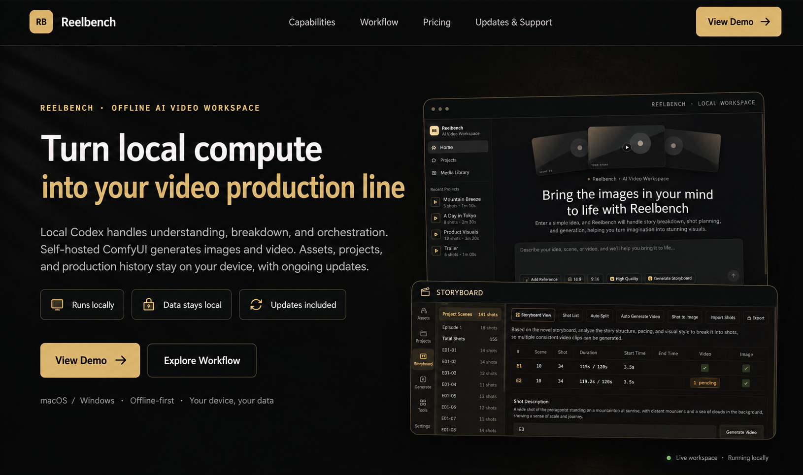
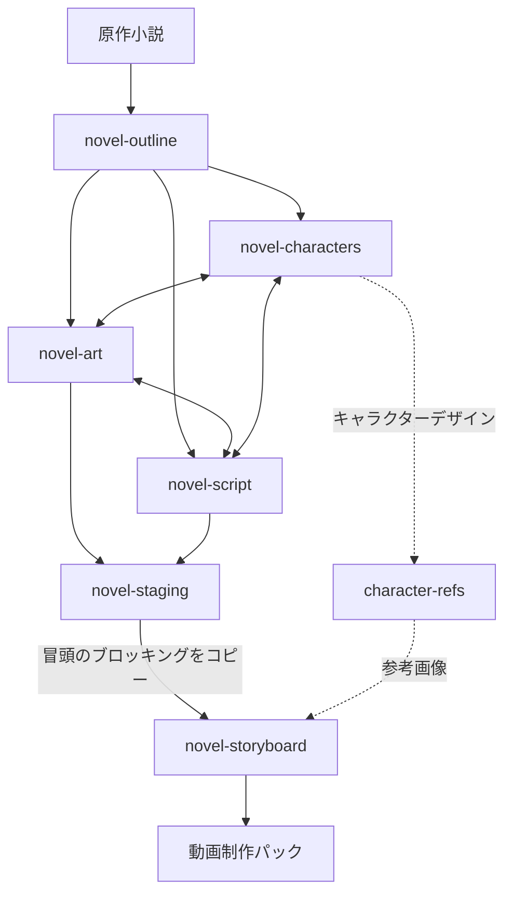

<div align="center">

# shuohao-skills

**AIショートドラマ制作のための、エージェント非依存スキル集**

[English](README.md) | [中文](README.zh.md) | 日本語 | [X @eternityspring](https://x.com/eternityspring)

**[スキル](#スキル) · [インストール](#インストール) · [動作要件](#動作要件) · [リポジトリの規約](#リポジトリの規約)**

</div>

> 👋 **お仕事・コラボレーション募集中** — 現在は求職中で、このリポジトリはその合間に作っているものです。
> 共感してくださる方がいれば、ぜひご連絡ください。**リモートワーク**に加えて、生活費として月数千元＋利益配分という**ハーフコラボ**にも対応できます。仕事上どうしても必要な場合は、現地への出張も可能です。本当にやりたいのは、このAIの波の中で一緒にものづくりをする、同じ波長の仲間を見つけることです。
> メール：**[eternityspring@gmail.com](mailto:eternityspring@gmail.com)** · 履歴書：**[resume.79px.com](https://resume.79px.com)** · WeChat **`hao_dev`**（追加の際は `github` と書き添えてください）
>
> これらのスキルは無料のオープンソースで、実際のAIショートドラマ制作の現場で作り込み、検証してきたものです。
> もし半日分の手間を省けたなら、[**Ko-fiでコーヒーをおごっていただける**](https://ko-fi.com/eternityspring)と嬉しいです ☕ — 更新を続ける励みになります。

## ❤️ スポンサー

> [ここに掲載を希望しますか？](mailto:eternityspring@gmail.com)

<details open>
<summary>クリックして折りたたむ</summary>

<table>
<tr>
<td width="180"><a href="https://go.apimart.ai/tw-shuohao-skills"></a></td>
<td>本プロジェクトをスポンサーしてくださっている <a href="https://go.apimart.ai/tw-shuohao-skills">APIMart</a> に感謝します！APIMart は、AIの画像・動画生成向けの低コストAPIプラットフォームです。GPT-Image-2 は1枚あたり $0.006 から、1ドルで160枚以上を生成できます。1つの非同期APIで画像と動画の両方に対応しており、タスクを送信してIDを受け取り、ポーリングまたはコールバックで結果を取得します。タイムアウトなしで数万枚規模のバッチ処理ができ、コードを変えずにモデルを切り替えられます。月額固定費のない従量課金制です。<a href="https://go.apimart.ai/tw-shuohao-skills">こちらから登録</a>してご利用ください。</td>
</tr>
<tr>
<td width="180"><a href="https://studio.reelbenchai.com"></a></td>
<td><a href="https://studio.reelbenchai.com">Reelbench Studio</a> は、これらのスキルの作者が作った有料のAI動画ワークスペースで、オフラインで動作するソースコードとして提供されます。ローカルの Codex が理解・分解・オーケストレーションを担当し、セルフホストの ComfyUI が画像と動画を生成するため、素材やプロジェクトは手元のマシンから出ません。</td>
</tr>
<tr>
<td width="180"></td>
<td>赛博班底（サイボーグ・バンディ）は、これらのスキルの作者が作ったWeChatミニプログラムです。AIショート動画向けの参考画像（キャラクター、衣装、表情など）を、カテゴリやタグで絞り込んで探せます。どの画像にも、ワンタップでコピーできる中国語プロンプトが付いており、原寸画像を長押しして保存できます。WeChatで左のコードを読み取ると開きます。</td>
</tr>
</table>

</details>

## スキル

**AIショートドラマ制作のための、エージェント非依存スキル集** — 小説から撮影可能な素材まで、キャラクターバイブル、脚色アウトライン、シーン・小道具バイブル、脚本、冒頭の立ち位置設計（ステージング）、ストーリーボードを一貫して扱います。各スキルは自己完結しており、`SKILL.md` を読み込み、同梱のスクリプトを実行できるエージェントであればどれでも動作します。Claude Code と Codex は対応例の2つであり、必須ではありません。

現在のリポジトリには**7つのスキル（6つの制作ステージ＋単体で使えるキャラクター参考画像の生成）**が含まれています。アウトラインで脚色の方針を固め、キャラクター・美術・脚本は相互に往復しながら磨き込み、ステージングでストーリーボードの前に各シーンの冒頭の立ち位置を確定させます。



| スキル | 内容 |
| --- | --- |
| [**novel-outline**](skills/novel-outline/README.en.md) | 小説を5点セットのショートドラマ・アウトラインに脚色します：脚色方針、キャスト、ビート、各話のあらすじ、アセット一覧（物語上の小道具表を含む）。14項目の品質ゲートをすべてスクリプトでチェックし、既存アウトラインの点検モードも備えます |
| [**novel-characters**](skills/novel-characters/README.en.md) | アウトラインで確定したキャストを、キャラクターバイブル（プロフィール、デザインプロンプト、ボイスプロンプト、モデルシート）にまとめます。outline.json から人物一覧を自動で取り込み、レポートの言語も設定できます |
| [**character-refs**](skills/character-refs/README.en.md) | あらゆる物語（小説に限らず、オリジナルの物語でも可）のキャラクター参考画像を**実際に生成**します。キャラクターを1通のメッセージで説明すると、項目に分解し、不足分を補って確認したうえで、正面全身のアンカー画像を生成します。ほかのすべてのビュー（顔アップ、90°横向き、背面、ディテール）はこのアンカーだけを参照し、必要に応じて段階的に生成されます。各画像にはラベルが付き、個別に再生成でき、古くなったものは追跡されます。Qwen Image（ComfyUI）、codex の画像生成、GPT Image 2 API、またはカスタムコマンドで動作します |
| [**novel-art**](skills/novel-art/README.en.md) | AI制作向けの美術バイブル（シーン＋物語上の小道具）：一貫性のアンカー、照明と状態のバリエーション、スケール参照、人物・手なしのホワイトプレート。outline.json から取り込み、10項目の品質ゲートをすべてスクリプトでチェックします |
| [**novel-script**](skills/novel-script/README.en.md) | AIショートドラマ向けの脚本執筆：シーン＋ビートの流れ（アクションのビートとセリフが交互に並ぶ）、読み上げ速度から決定的に算出される各話の尺、冒頭3ビート以内のコールドオープン・フックのゲート、TTSにそのまま渡せるボイスプロンプト付きのキャラクター別セリフ集。10項目の品質ゲートをすべてスクリプトでチェックします |
| [**novel-staging**](skills/novel-staging/README.en.md) | 脚本とシーン画像から冒頭の立ち位置を設計します：各キャラクターの座席または立ち位置、向き、冒頭での存在の有無、エキストラ。staging.json、編集可能な俯瞰レポート、ストーリーボード用の冒頭ブロッキング文を出力します。8項目の品質ゲートをすべてスクリプトでチェックします |
| [**novel-storyboard**](skills/novel-storyboard/README.en.md) | AIショートドラマ向けのストーリーボード：セグメント（1回の生成、15秒以内）→ カット（2〜5秒、厳格なゲート）→ キーフレーム（マスターは0.00秒に固定、サブフレームは各カットの境界に配置）。MiniMax H3 のプロンプトとの整合、およびカット時間を原文のまま監査します。デザインシートを参照して実際にフレームを生成し、ワンコマンドで H3 / Seedance の制作パックも作成できます。18項目の品質ゲートをすべてスクリプトでチェックします |

**6つのパイプラインスキルはすべて、レポートを英語でも出力できます** — レポートの既定UIは中国語です。`render` に `--lang en` を渡すと、完全な英語レポートになります（データの内容は作成したままです）。character-refs は中国語・英語・日本語のUIを同梱しており、そのほかの言語はその場で翻訳します。

## シーンステージング：入力、出力、引き継ぎ

`novel-staging` は脚本の後、ストーリーボードの前に実行します。シーンとキャストは `script.json` から読み込みます。`art.json` はロケーション、`outline.json` はキャラクター名を提供し、シーン画像は人物が脇に立ったり座ったりできる物体を示します。脚本は必須で、ほかの入力は結果の質を高めます。シーン画像がない場合、美術仕様から推測した位置は暫定として扱われます。これらのファイルはどんな作成元のものでも構いません。ほかのスキルをインストールしておく必要はありません。

| 出力 | 内容 |
| --- | --- |
| `staging.json` | 各シーンの冒頭の存在、アンカーとなる物体、サイド、位置、姿勢、向き、エキストラ |
| `staging.md`（任意） | 一覧表、位置表、冒頭ブロッキング文をまとめたテキスト出力 |
| **`staging-report.html`（既定）** | ドラッグ可能な俯瞰図とライブチェックを備えたインタラクティブなツールレポート。編集内容はJSONに書き出せます |
| `blocking` コマンドの出力 | シーンごとの冒頭ブロッキング文を1つずつ出力します。最初のストーリーボード・セグメントにそのままコピーできます |

エージェントがシーン画像を読み取ってステージングを設計し、同梱のNode.jsツールがデータの初期化、8つのゲートのチェック、レポートの描画、ブロッキング文の生成を行います。HTMLのツールレポートがユーザー向けの既定の成果物で、ブラウザでローカルに開けます。JSONは作業用データで、Markdownは要求があったときだけ生成されます。完成済みのサンプルをリポジトリのルートから試すには：

```bash
node skills/novel-staging/scripts/novel-staging.mjs validate skills/novel-staging/examples/渡口-staging.json --script skills/novel-staging/references/test-fixtures/upstream/渡口-script.json --art skills/novel-staging/references/test-fixtures/upstream/渡口-art.json
node skills/novel-staging/scripts/novel-staging.mjs render skills/novel-staging/examples/渡口-staging.json --lang en > staging-report.html
node skills/novel-staging/scripts/novel-staging.mjs blocking skills/novel-staging/examples/渡口-staging.json --lang en
```

**ストーリーボードは、まだ `staging.json` を自動では取り込みません。** 承認済みの冒頭ブロッキング文をエージェントに渡し、それぞれを該当シーンの最初のセグメントにコピーするよう依頼してください。このステージが出力するのはステージングのデータとレポートで、画像や動画は生成しません。新しいステージング計画の作り方は[スキルガイド](skills/novel-staging/README.en.md)を参照してください。

## 5つのステージレポートを1ページに

アセンブラは現在、**アウトライン、キャラクター、美術、脚本、ストーリーボード**に対応しています。ステージングのレポートと character-refs のギャラリーは含まれません。対応する5つのレポートを、左側にナビゲーションを備えた1ページに統合できます — **手元にある対応ステージの分だけ、ペインが作られます**：

```bash
node scripts/report.mjs --from <demo-dir> --out report.html
```

`--from` は[作業ディレクトリの規約](#リポジトリの規約)に沿って5つのjsonファイルを探し出します。各ファイルを直接指定することもできます（`--outline` `--cast` `--art` `--script` `--storyboard`）。キャラクターのパスしか実行していない場合は、ペインが1つできるだけで、エラーにはなりません。

これは**アセンブラであり、独立したスキルではありません**。スキルのコードはインポートせず、各スキル自身の `render --html` を呼び出して結果をつなぎ合わせます。そのため5つのスキルには手を加えず、単体で実行でき、単体でコピーもできます。スキル側のレンダリングが変わっても、自動的に反映されます。

統合で生じる3つの問題は、**すべてアセンブラ内で解決しており、スキル側には手を入れていません**：

- **スタイルの漏れ。** 5つのレポートは57個のクラス名を共有しており、うち13個はレポートごとに意味が異なります（`.copy`、`.kpis`、`.badge`、`.chip`…）。そのため、すべてのセレクタにスコープ用のプレフィックスを付けます
- **スクリプトの漏れ。** 各レポートのスクリプトは `document.querySelector('.expo')` のようにドキュメント全体を検索します。統合すると最初の1つしか見つからず、5つのエクスポートボタンがすべて壊れてしまいます。そこで各スクリプトをスコープ用のプロキシで包みます
- **アセットのパス。** 各レポートの画像は自身のjsonのディレクトリからの相対パス（`images/…`、`E01-01/f1.png`）になっているため、出力ファイルを基準に付け替えます

既定では一度に1つのペインだけを表示します（5つ合わせると約60万文字になります）。左下の「すべて表示」を押すと全ペインが展開され、Cmd+F でドキュメント全体を検索できます。数字キー `1`〜`5` でペインを切り替えられ、`#pane-script` のようなリンクで特定のペインに直接移動できます。

```bash
node scripts/report-selftest.mjs   # 92個のアサーション、ブラウザ不要
```

6つの制作ステージのレポート：

**novel-outline · ショートドラマ脚色アウトライン**


**novel-characters · キャラクターバイブル**


**novel-art · 美術バイブル（シーン＋小道具、シートはスキルが実際に生成）**


**novel-script · 脚本（尺ゲージ＋各話の脚本＋セリフ集）**


**novel-staging · 冒頭のステージング（人物をドラッグして配置できる俯瞰図、書き出し可能）**


**novel-storyboard · ストーリーボード（カットのリズムストリップ＋スキルが実際に生成したマスター/サブのキーフレーム＋H3プロンプト）**


こちらは小説が不要です — どんなキャラクターでも、本物の参考画像を作れます：

**character-refs · キャラクター参考画像（アンカーはGPT、ほかはQwen、すべてスキルが実際に生成）**


## インストール

```bash
git clone https://github.com/eternityspring/shuohao-skills.git
cd shuohao-skills
./scripts/install.sh
```

インストーラーは現在 Claude Code と Codex を検出し、すべてのスキルを所定の場所に**シンボリックリンク**します。そのため `git pull` するだけで即座に反映され、再インストールは不要です。スキル自体は、どちらのランタイムにも依存しません。ほかのエージェントでは、スキルのディレクトリをそのエージェントのスキルディレクトリにコピーまたはシンボリックリンクするか、`SKILL.md` を直接読み込んでください。

```bash
./scripts/install.sh novel-characters   # 1つのスキルだけ
./scripts/install.sh --codex            # codex にだけインストール
./scripts/install.sh --uninstall        # シンボリックリンクを削除
```

手動で行う場合：

```bash
AGENT_SKILLS_DIR=/path/to/your-agent/skills
ln -s "$PWD/skills/novel-characters" "$AGENT_SKILLS_DIR/novel-characters"
ln -s "$PWD/skills/novel-characters" ~/.claude/skills/novel-characters
ln -s "$PWD/skills/novel-characters" ~/.codex/skills/novel-characters
```

## 動作要件

| | 必須か | 備考 |
| --- | --- | --- |
| **Node** | 必須 | 18以上。スキルのスクリプトは標準ライブラリのみを使用します — **npm依存なし、追加インストールも不要です** |
| **モデルの利用枠** | 必須 | 現在のセッションの利用枠を使用します。**APIキーは不要です** |
| **エージェントのランタイム** | 必須 | `SKILL.md` を読み込み、同梱のNode.jsスクリプトを実行できるエージェントであればどれでも。Claude Code と Codex は対応例です |
| **画像モデル** | character-refs のみ | 次のいずれか：手元の ComfyUI（Qwen Image）、ローカルの codex 画像生成（ChatGPT プランの利用枠を使用）、OpenAI の APIキー（GPT Image 2）、またはカスタムコマンド。初回利用時に選択します |

> **出力言語についての注意。** これらのスキルは中国語を第一に設計されています。`novel-characters` は、原作が英語の小説であっても中国語のキャラクタープロフィールを出力し、バリデーターはそれらの項目に英語が含まれていると積極的に弾きます。変更するために必要なことは、そのスキルのREADMEを参照してください。

## リポジトリの規約

スキルごとに1つのディレクトリを置き、**自己完結していて、単体でコピーできる**ようにします：

```
skills/<skill-name>/
├── SKILL.md          エージェントが読むワークフロー（必須）
├── README.md         人が読むドキュメント
├── scripts/
│   ├── <name>.mjs    決定的なヘルパー、依存なし
│   └── selftest.mjs  セルフテスト、モデルは呼び出さない（必須）
├── references/       詳細な指示、必要に応じて読み込み
├── examples/         同梱のサンプル。テストフィクスチャも兼ねる
└── assets/           スクリーンショット
```

2つの必須要件：

- すべてのスキルに `SKILL.md` が必要です
- すべてのスキルに、**モデルを呼び出さず、利用枠も消費しない** `scripts/selftest.mjs` が必要で、決定的なロジックをすべてカバーしている必要があります

スキルを追加する前に、すべてのセルフテストを実行してください：

```bash
for f in skills/*/scripts/selftest.mjs; do node "$f"; done
```

CIはありません — セルフテストは1秒ほどで終わるため、パイプラインを待つよりローカルで実行するほうが速いからです。**動作確認はmacOS＋Node 24のみ**です。プラットフォーム固有のコードはないため、Linuxや古いNodeでも動くはずですが、未検証です。


## Star history

[](https://star-history.com/#eternityspring/shuohao-skills&Date)


## ライセンス

[Apache 2.0](LICENSE)
